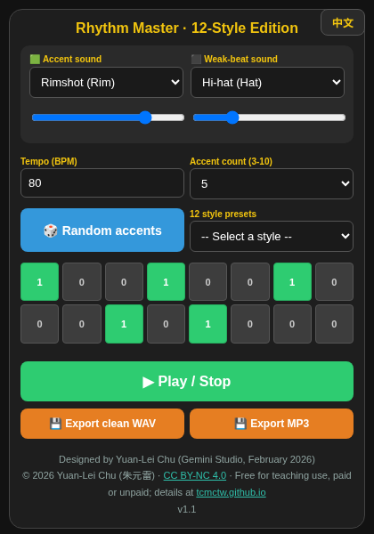

# Rhythm Master · 12-Style Edition - User Manual

Designed by Yuan-Lei Chu · CC BY-NC 4.0

## What this tool does

- This app trains recognition of different accent placements within a 16-beat pattern.
- The main screen shows 16 cells: one bar (4 beats) divided into 16 parts - each cell is a 16th note. Green cells mark the accents.

## Basic operation

- Green cells are accented (strong) hits; non-green cells are weak hits. You can choose the timbre of the accent and the weak beat separately.
- BPM is the tempo in beats per minute; the default is 80 BPM.
- Accent count: set how many accents to use; the app allows 3 to 10.
- Random accents: let the computer place the accents randomly, or tap the cells yourself to add or remove accents.
- 12 style presets: choosing a style lets the app place the accents according to that style.
- Press "Play" to hear the 16-beat pattern of accents and weak beats; press "Export clean WAV" or "Export MP3" to download a file of your own rhythm: Perfect_Click_80.wav or Perfect_Click_80.mp3 (MP3 is smaller and easier to share with students).
- Language: the "EN／中文" button in the top-right corner switches the interface between Chinese and English.

## Troubleshooting

- **No sound?** Check the device volume and that the browser is allowed to play audio; do not use silent mode on iPhone. The browser allows sound only after your first tap on the page.

## Credits and license

- Program: Gemini Studio · Designed: February 2026 · Designer: Yuan-Lei Chu (朱元雷)
- Version: v1.1 (MP3 export added November 2026; the current version is shown in the page footer)
- MP3 encoding: lamejs 1.2.1 (LGPL-3.0); see lamejs-LICENSE.txt
- © 2026 Yuan-Lei Chu · This tool is licensed under CC BY-NC 4.0 · Free for teaching use, paid or unpaid; details at tcmctw.github.io
